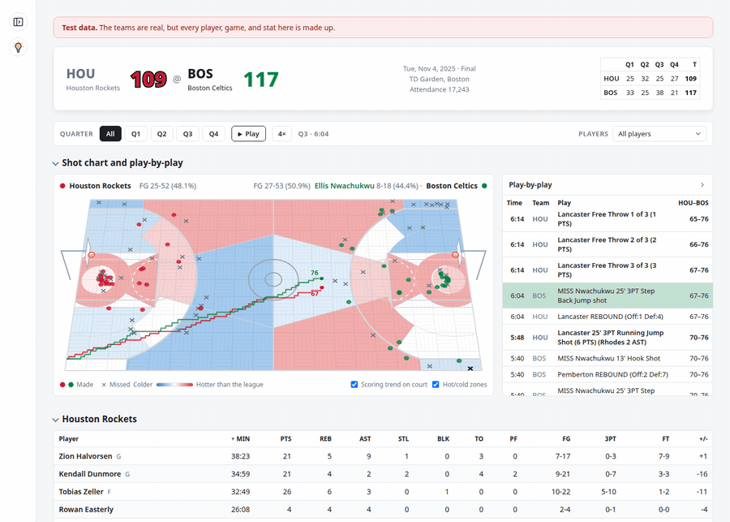
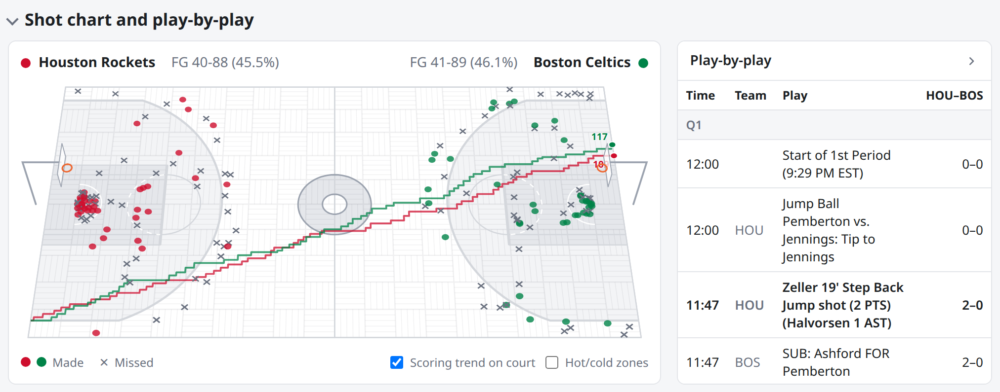
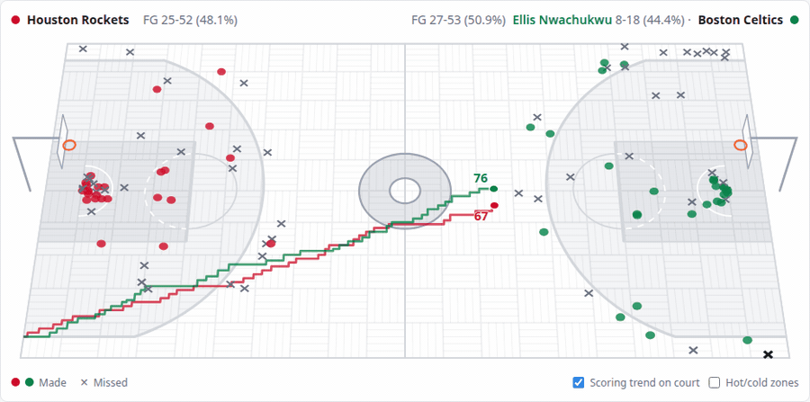
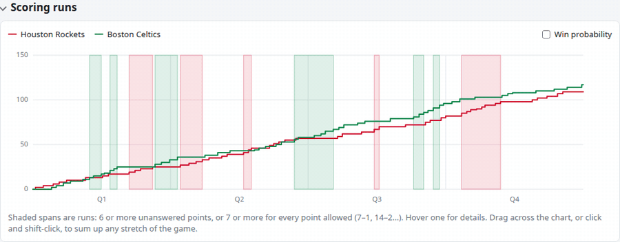
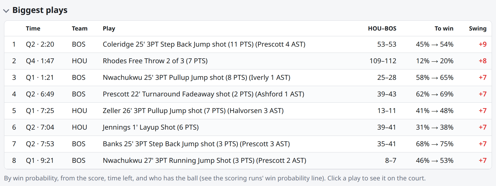
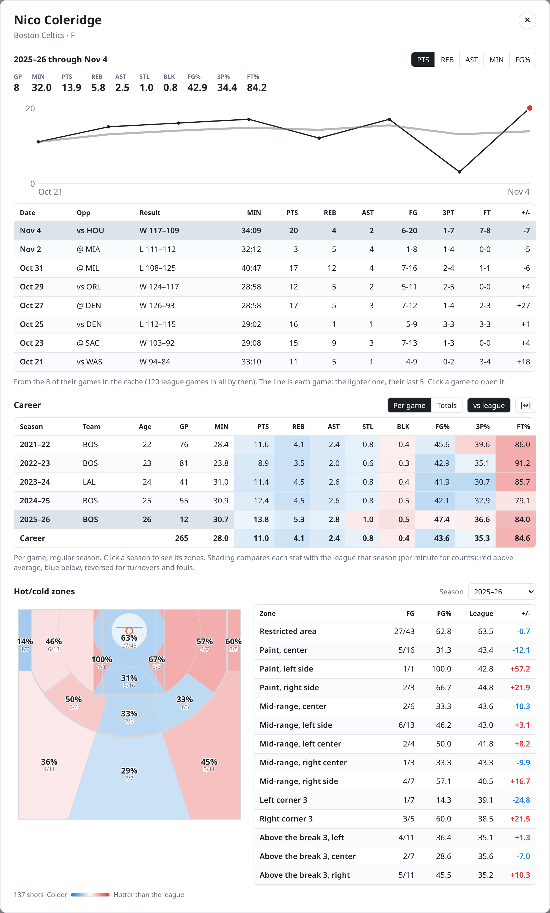
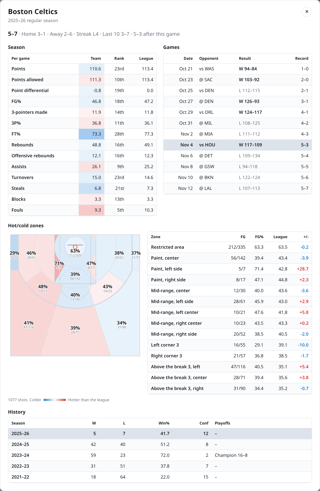

# NBA Box Scores

Pick an NBA team, a season, and a date it played to see that game: the box
score, every shot on a 3D court, the play-by-play, and how the score moved.
The data comes from stats.nba.com (the API behind
[nba_api](https://github.com/swar/nba_api)), and every response is cached in
SQLite so a game is only ever fetched once.  There's no hosted website because there are some pretty explicit licensing restrictions on the data from the NBA API, and I really just wanted to build a POC and play around with some data visualizations.



## What's on a game's page

The pictures here are a made-up season (see
[Trying it with fake data](#trying-it-with-fake-data)), taken by
`bin/readme-screenshots`.

### Shot chart and play-by-play

Every field goal attempt on a 3D court, with the play-by-play beside it.
Hovering a shot or a play highlights the other; clicking a play jumps the
court to that moment in the game. Each arena has its own floor: wood
planks, with Boston's parquet, Orlando's squares, and Brooklyn's
herringbone.



- **Playback** replays the game's shots in order, with the clock, score,
  and FG counts following along, at ½×, 1×, 2×, or 4×. Space plays and
  pauses, and the arrow keys step through quarters.
- **Hot/cold zones** shade stats.nba.com's 14 shot zones by how each team
  shot there against the league that season (red hotter, blue colder).
  Hovering a zone outlines it.
- **Filters** narrow the court and the play-by-play to any quarter, and to
  any set of players.



### Scoring runs

The running score over the game, with scoring runs shaded. Switch on the
win probability line, and its biggest swings are shaded instead. During
playback it draws along with the game. Drag across it to sum up any
stretch.



### Biggest plays

The baskets that swung the win probability most, each a click from its
moment on the court.



### Box scores and lineups

- **Scoreboard and box scores**: the final, the line score by quarter, and
  each team's player stats, sortable by any column.
- **Lineups**: every five-man unit each team played, with its minutes and
  what it outscored the other team by, worked out from the play-by-play's
  substitutions.

### Player and team cards

<p>
  
  
</p>

- **Player cards**: clicking a name in a box score opens the player's
  season so far, up to the game on screen: their averages, a trend across
  their games, and their game log (click a game to open it). Then their
  regular-season career, per game or in totals, with every stat a click
  away, and each stat shaded against the league that season. Below it are
  their hot/cold zones for the season so far or any season from 1996–97
  on, on a half court seen from above.
- **Player search**: type a name in the control panel to find anyone who
  has played in the league, current or retired, and open their card.
- **Team cards**: clicking a team's name on the scoreboard opens its
  regular season: its record (and where it stood after the game on
  screen), each stat ranked against the other 29 teams and shaded against
  the league, every game it has played (click one to open it), its
  hot/cold zones, and the franchise's history: every season's record,
  conference finish, and playoff run, under whatever name it had.
- **Card tables** sort by any column, like the box scores: a player's
  career, a team's season stats (by rank, say), and either card's zones.
  Each table remembers its sort.

### Links and settings

The game on screen is in the URL, so any view can be bookmarked or shared,
along with its quarter, players, and any card open over it (and the season
of zones a player card shows). Opening a card adds it to the browser's
history, so Back closes it. Coming back without a link reopens the last
game, but not a card left open on it.
Settings (light or dark, collapsed panels, toggles, playback speed, sorts)
are remembered in the browser.

## Getting started

You'll need Node 24.2 or newer.

```sh
bin/setup    # check Node, install dependencies, create .env
bin/server   # http://localhost:3000
```

`.env` (copied from `.env.example`) can set:

| Variable | Default | What it does |
| --- | --- | --- |
| `PORT` | `3000` | Port the server listens on |
| `NBA_CACHE_DB` | `data/nba-cache.sqlite` | Where the response cache lives |
| `NBA_RETRY_DELAY_MS` | `1000` | Pause before retrying a failed stats.nba.com request |
| `NBA_OFFLINE` | unset | `1` serves only what's cached, never asking stats.nba.com (like `bin/server --offline`) |

## Scripts

Every script takes `--help` and can be run from any directory.
[bin/README.md](bin/README.md) has the details: every option, what each
script does under the hood, and what to watch out for.

| Script | What it does |
| --- | --- |
| `bin/setup` | Checks Node, runs `npm install`, and creates `.env` if there isn't one |
| `bin/server` | Starts the server (`--port`, `--cache-db`, `--watch` to restart on changes, `--offline` to never ask stats.nba.com) |
| `bin/test` | Runs the tests (`--name` to filter, `--watch`, `--coverage`) |
| `bin/lint` | Checks style and likely mistakes with ESLint (`--fix` to fix what it can) |
| `bin/cache` | Shows the cache's size by endpoint (`--stats`), deletes expired responses (`--prune`), a season (`--prune-season`), or everything (`--clear`); `--cache-db` picks the file |
| `bin/backfill` | Fetches and caches every game in a finished season, one request every 2 seconds (`--season`, `--delay`) |
| `bin/index` | Adds the games already in the cache to the season index the player cards read (`--season`, `--rebuild`, `--cache-db`) |
| `bin/readme-screenshots` | Takes the screenshots in `images/` from a fake season in headless Chrome (`--team`, `--seed`, `--seconds`) |
| `bin/load-fixtures` | Fills a separate cache with a fake season to try the app on (`--games`, `--seed`, `--season`, `--reset`) |

## Trying it with fake data

Real games come from stats.nba.com one request at a time, so there's little
to look at until a season is backfilled. For a quick start, load a fake
season and point the server at it:

```sh
bin/load-fixtures            # 10 games per team in data/fixtures.sqlite
bin/server --cache-db data/fixtures.sqlite
```

The teams are real; the players, schedule, and games are made up. Each game
is simulated play by play, so its box score, play-by-play, shot chart, and
line score agree, and players keep the same profile from game to game.
`--games 82` makes a full season, and `--seed` makes a different one.
The fixtures cache is marked as test data: every game served from it says
so in a red notice above the scoreboard, and the server never asks
stats.nba.com for anything while serving it, so real games can't mix in.
The fixtures never touch the real cache either.

To serve only what's cached from the real cache too, start the server with
`bin/server --offline` (or set `NBA_OFFLINE=1` in `.env`).

## How it works

- **`server.js`** is an Express app serving `public/` and a small JSON API
  (`/api/teams`, `/api/games`, `/api/boxscore`, `/api/playbyplay`,
  `/api/shotchart`, `/api/shotzones`, `/api/players`, `/api/player`,
  `/api/playerseason`, `/api/playerzones`,
  `/api/lineups`, `/api/team`, `/api/teamzones`, `/api/teamhistory`, `/api/league`,
  `/api/info`). A player card gets the league totals for its
  whole career from `/api/league` in one request.
- **`season-index.js`** keeps an index of the cached games beside the
  responses: one row per game, per player per game, and per shot. A
  player's season up to any date is then one query (`/api/playerseason`),
  instead of parsing every game their team played. Final regular-season
  games join it as they're cached; `bin/index` adds games cached before.
- **`nba-api/`** is a JavaScript port of the parts of nba_api this app uses:
  the stats.nba.com endpoints, their parameters, and the headers the site
  expects. Responses are cached in SQLite by request URL (`nba-api/cache.js`):
  forever once a game is final, for a minute while it's in progress.
- **`public/`** is the front end, with no build step. `app.js` starts the
  page and wires up its events. Each part of the page is a module in
  `public/ui/` (box score, shot chart, zones, playback, play-by-play, scoring
  trend, player card, and so on), sharing what's on screen through
  `ui/state.js`. Pure logic, which the tests cover, lives in `public/lib/`
  (court projection, shot zones, stat sorting, saved settings).
- **`dev/`** has tools for working on the app; `fake-season.js` makes the
  fake games for `bin/load-fixtures`.
- **`test/`** uses Node's built-in test runner. stats.nba.com is stubbed and
  the cache is in memory, so the tests never touch the network or
  `data/`. The page is tested in jsdom: the real `index.html` and `app.js`,
  served by the real server on a small fake season, clicked through like a
  user would, and checked for accessibility problems with axe-core.
- **`.github/`** runs lint, the tests (with coverage on each run's summary
  page), and `npm audit` on every push; CodeQL's security scan while the
  repository is public; and Dependabot's weekly update pull requests.

stats.nba.com has no published rate limit and sometimes stalls requests that
come too fast, so failed requests are retried once, and `bin/backfill`
spaces its requests out.

More ideas and smaller fixes are in [todo.md](todo.md).

## License and the NBA's data

The code is MIT-licensed; see [LICENSE](LICENSE). That includes
`nba-api/`, a JavaScript port of [nba_api](https://github.com/swar/nba_api)
written for this project. It follows nba_api's design, endpoints, and
parameters, so nba_api's own MIT notice is included as its license asks,
in [nba-api/NBA_API_LICENSE](nba-api/NBA_API_LICENSE).

This project isn't affiliated with or endorsed by the NBA. Its data comes
from stats.nba.com, an unofficial API, and belongs to the NBA; it's meant
for personal, non-commercial use, under the terms of use of
[NBA.com](https://www.nba.com/termsofuse). The repository holds no NBA
data: the cache stays on your machine, and the screenshots are of a
made-up season. Team names are the teams' own, used to say which is
which.
